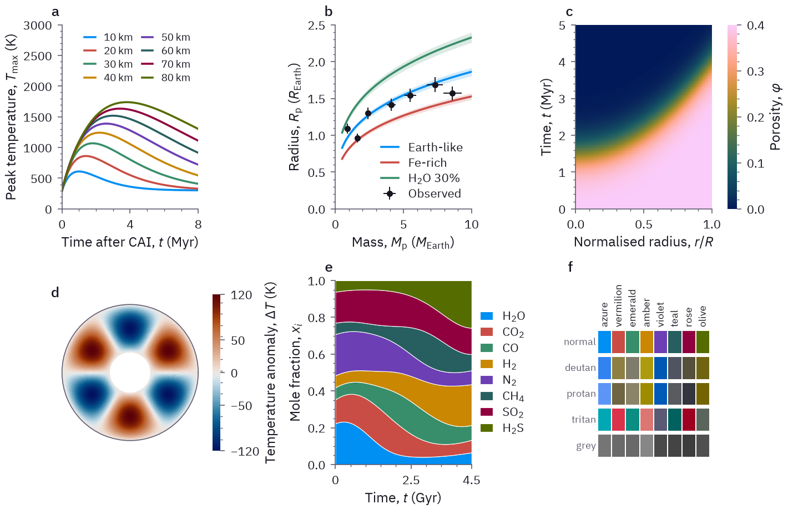

# fwl-mpl

Matplotlib style for Forming Worlds Lab figures in papers, reviews and documentation pages. It sets an 8-colour palette that stays distinct for readers with colour-vision deficiency, IBM Plex Sans type with a true italic for math variables, the Crameri scientific colour maps, and light and dark modes.

<picture>
  <source media="(prefers-color-scheme: dark)" srcset="docs/specimen_dark.png">
  
</picture>

## Install

```bash
pip install "fwl-mpl @ git+https://github.com/FormingWorlds/fwl-mpl"
```

The package needs Python 3.10 or newer, matplotlib 3.7 or newer and `cmcrameri`. The fonts ship with the package, so nothing is installed system-wide.

## Use

```python
import matplotlib.pyplot as plt
import fwl_mpl

fwl_mpl.use()  # light mode: white background, for papers
fwl_mpl.use("dark")  # dark mode: for dark documentation pages and slides

fig, ax = plt.subplots()
ax.plot(t, T)  # lines follow the 8-colour cycle
ax.set_xlabel(r"Time, $t$ (Myr)")
fwl_mpl.panel_label(ax, "a")
problems = fwl_mpl.finish(fig)  # labelled axis ends, then a layout check
assert not problems, "\n".join(problems)
fig.savefig("figure.pdf")
```

The style sheets also work on their own: `plt.style.use("fwl_mpl.light")` or `plt.style.use("fwl_mpl.dark")`.

The default figure is 3.5 by 2.6 inches, for one column of a two-column page. A figure across both columns of an AASTeX page is 7.1 inches wide. The saved file keeps the figure size. Tick labels and legends are 8 pt, axis labels 9 pt and panel labels 9.5 pt. PDF and PostScript output embed the fonts as TrueType; SVG output draws text as paths, so it shows the same type where the fonts are not installed.

### From Julia

Erebus.jl and other Julia code plot through PyPlot, which runs matplotlib in the Python that PyCall uses. Install the package into that Python (its path is `PyCall.python`), then:

```julia
using PyCall
pyimport("fwl_mpl").use()
```

## Layout rules

Lab figures follow 2 rules:

1. Text never sits on data. Legends, labels, annotations and tick labels do not overlap lines, markers, error bars, axis lines, colour bars or other text.
2. Both ends of every axis and of every colour bar carry a number, so a reader sees the range they cover.

`fwl_mpl.finish(fig)` applies the second rule and checks both; call it after the last change to the figure and before saving. It returns a list of the problems that remain, one line each, and an empty list for a figure that follows the rules. In detail:

- An axis with automatic limits gets an even tick grid just outside its data. The tick step is the coarsest of 1, 2, 2.5 and 5 times a power of ten that widens the data range by at most 10 % and fits the axis length; on a short axis, ticks go on every few grid lines, at even spacing and on both limits. Logarithmic axes go to whole decades. A shared or twin axis covers the data of every axes that shares it, and an inverted axis stays inverted.
- An axis with limits set by hand, or one whose data allow no such grid, gets its exact end values as labelled ticks (`fwl_mpl.label_ends(ax)` does this alone); on a logarithmic axis, powers of ten go between the ends and the default minor labels are turned off. `ax.set_ylim(bottom=0)` sets both limits by hand, so the other end gets its exact value too; set both limits to tick values for round ends. Axes that hold an image, a mesh or filled contours (for `pcolor` and `contourf`, matplotlib 3.8 and later) keep their data limits, moved onto a tick when it lies within 2 % of the range.
- Markers of a series that lies inside its axes are drawn whole, so a point on an axis limit is not cut in half (a clip path set by hand stays); they stay unclipped if the limits change later. Inset axes follow the same rules. Secondary axes keep their own ticks and are not checked for labelled ends.
- An axis with its own tick locator or formatter, for example integer ticks or percent labels, keeps its ticks, and `finish` reports its unlabelled ends; set the limits to tick values to clear them. An axis with dates or categories keeps its ticks and is not checked for labelled ends.
- A colour bar made with `fig.colorbar` whose ends carry no tick gets its end values as ticks, unless its ticks or format were set by hand; `finish` then reports its unlabelled ends. Use `fwl_mpl.colorbar` instead to choose: `fwl_mpl.colorbar(im)` widens a linear colour range outward to tick values when that adds at most 10 % to the range, and otherwise rounds each end outward to 2 significant digits and labels it, so data from 0.000918805 to 3.29872 give a bar from 0.00091 to 3.3. When 2 digits would widen the range by more than 10 %, it uses up to 6 (data from 1001.3 to 1008.7 give 1001 to 1009), and tick values when 6 still would. A logarithmic norm goes to whole decades, a contour set keeps its levels, and other norms keep their range with the end values as ticks. `fwl_mpl.colorbar(im, ends="label")` keeps the range, for example a symmetric diverging one, and labels its ends to 6 significant digits. Inner ticks that a 6-digit label cannot show, or that would print like an end, are left out, here and on axes with labelled ends.

Placing text is left to the author. When `finish` reports a collision, move the legend to where the data leave room (`loc=`), make that room with a wider axis range whose limit is a tick value, put the legend outside the axes, or shorten the label. `fwl_mpl.check_figure(fig)` runs the check alone. It tests rotated text by its axis-aligned bounding box, so rotated labels need clear space, and it tests an annotation by its text, not its arrow. It does not treat filled areas (bars and histograms included) or images as obstacles, nor data hidden behind an inset with an opaque background, and it does not test polar, 3D and secondary axes, or axes with dates or categories, for labelled ends. A colour bar counts as data, also where its outline is hidden.

Constrained layout places text a little differently at another resolution, and `savefig` lays the figure out again at the resolution it saves at. `finish` and `check_figure` therefore lay the figure out at `rcParams["savefig.dpi"]` (300 dpi in the lab styles), as `savefig` does for PNG files and, from matplotlib 3.11, for PDF, SVG and PostScript files. Before 3.11, vector files are laid out with their own text sizes, so text in them can sit more than 1 pt away from where the check saw it. When you save at another resolution, give it to both: `fwl_mpl.finish(fig, dpi=600)` and `fig.savefig("figure.png", dpi=600)`. The specimen at the top passes the check in both modes, and a test keeps it that way.

## Colours

| Name | Light | Dark |
|---|---|---|
| azure | `#008FF3` | `#59B1EE` |
| vermilion | `#C94D45` | `#DC4C00` |
| emerald | `#388E6A` | `#B7E2B2` |
| amber | `#C98702` | `#FCB71E` |
| violet | `#6C3FB4` | `#8A67F2` |
| teal | `#275F60` | `#46999E` |
| rose | `#90003E` | `#BA6384` |
| olive | `#556C00` | `#98AB71` |

`fwl_mpl.colors(n, mode)` gives the first `n` colours of a cycle, `fwl_mpl.PALETTE[mode][name]` a single colour by name, and `fwl_mpl.SURFACES[mode]` the neutral colours: `background`, `ink` (text and boxplots), `muted` (axes and ticks), `line` (grid) and `observed` (measured data points, the same colour as `ink`).

Each mode has its own palette. In each one, the closest pair of colours is at least CAM02-UCS ΔE 12 apart for normal vision and for full-severity deuteranomaly, protanomaly and tritanomaly (simulated with `colorspacious`); the measured minimum is 12.6 in light mode and 12.3 in dark mode. At partial severities, sampled in steps of 1 %, the minimum is lower: 12.2 in light mode (deuteranomaly at 88 %) and 11.9 in dark mode (protanomaly at 92 %). With the same measure, the 7-colour Okabe-Ito palette (without black) scores 11.0. The `observed` colour is at least ΔE 12 from every palette colour too. Every colour has at least 3:1 contrast against the light background and 4.5:1 against the dark one. The tests check these limits.

For more than 8 series, vary the line style or use a sequential colour map.

### Colour maps

| Role | Light | Dark |
|---|---|---|
| sequential | `cmc.batlow` | `cmc.batlow` |
| diverging | `cmc.vik` | `cmc.berlin` |
| cyclic | `cmc.romaO` | `cmc.romaO` |

`fwl_mpl.cmap("diverging", mode)` returns the map for a role; `cmc.batlow` is the default image colour map. The maps are from Crameri, F., Scientific colour maps, Zenodo, doi:10.5281/zenodo.1243862; cite them when a figure uses one.

## Documenter.jl pages

`fwl_mpl.docs_theme` restyles the stock Documenter.jl light and dark themes with the lab palette and IBM Plex, so a Julia docs site matches the figures. The stylesheet is generated from the palette, so the figures and the pages stay on one set of colours. Run, from the repository that holds the docs:

```bash
python -m fwl_mpl.docs_theme docs/src/assets
```

then list the stylesheet in `docs/make.jl`:

```julia
format = Documenter.HTML(; assets = ["assets/fwl.css"])
```

The command writes `fwl.css` and the fonts (`fwl-fonts/`, about 1 MB, with the OFL licence) into the folder and replaces earlier copies; run it again after updating `fwl-mpl` so the pages follow palette changes.

The stylesheet applies to the Documenter light and dark themes, whether the reader's system setting picks them or the reader chooses one in the settings dialog. The catppuccin themes in that dialog keep their own colours.

Text and link colours are the palette hues moved toward the ink colour until they reach 4.5:1 contrast on every surface they appear on: the page, the code and sidebar backgrounds, and the admonition fills. Admonition borders use the unmodified palette, and their fills a 10 % tint of it; custom and `details` admonitions use the neutral colours. IBM Plex Mono comes in one weight without italic, and the stylesheet turns off synthetic bold and italic, so code comments are upright.

The selectors follow the class names of Documenter.jl 1.19. A later Documenter release can rename classes and leave single elements in the stock colours.

## Math and symbols

Math text uses IBM Plex Sans with its italic for variables and upright text for `\mathrm{}`. IBM Plex Sans covers the Greek alphabet with one exception that matters in practice: matplotlib draws `\phi` as ϕ (U+03D5), which the font lacks, so write `\varphi` for φ. The variant forms `\vartheta`, `\varpi`, `\varrho` and `\varkappa` and the archaic `\digamma` and `\backepsilon` are missing too and come from STIX Sans. Glyphs the font does not have, such as ∇, ∝, ⊕ and ☉, come from STIX Sans in math and from DejaVu Sans in plain text. Write `M_\mathrm{Earth}` rather than `M_\oplus`. With matplotlib 3.8 or newer, `fwl_mpl.use()` also sets bold italic math (`\mathbfit`) to IBM Plex Sans Medium Italic. IBM Plex has no calligraphic letters, so `\mathcal` draws the italic.

## Example

`pip install -e ".[examples]"`, then `python examples/specimen.py`, renders the specimen above in both modes to `examples/output/`.

## Development

```bash
pip install -e ".[test]" ruff
ruff check . && ruff format --check .
pytest --cov
```

## License

The code is licensed under Apache-2.0 (see `LICENSE`). The bundled IBM Plex Sans and IBM Plex Mono fonts are unmodified files from IBM, licensed under the SIL Open Font License 1.1 with the Reserved Font Name "Plex" (see `src/fwl_mpl/fonts/OFL.txt`).
